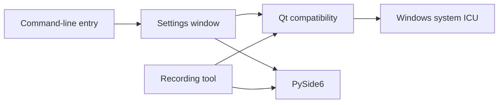

# AI Makeup Cam specification

This specification records the current Windows Qt startup requirement. The historical development contracts remain under `docs/dev/`.

## Table of Contents

- [Goal and scope](#goal-and-scope)
- [Module responsibilities](#module-responsibilities)
- [Startup behavior and limits](#startup-behavior-and-limits)
- [Acceptance criteria](#acceptance-criteria)

## Goal and scope

The application provides a PySide6 settings window for a live makeup camera and a separate recording tool. Both windows must start on supported Windows systems when another Python distribution exposes an incompatible ICU library with the same DLL name.

The change does not alter camera processing, application options, installed packages, or the behavior of non-Windows platforms.

[↑ Back to Table of Contents](#table-of-contents)

## Module responsibilities

The command-line entry point selects the settings window. The GUI and recording modules import a small Qt compatibility module before importing PySide6. The compatibility module prepares the Windows DLL loader; PySide6 remains responsible for loading Qt.

The compatibility module has no dependency on either window module, so both callers share the same initialization without a cycle.

[↑ Back to Table of Contents](#table-of-contents)

## Startup behavior and limits

On Windows, the compatibility module loads `icuuc.dll` from the Windows system directory before either window imports Qt. If that system DLL is unavailable, initialization continues and PySide6 reports its normal import error if it requires ICU. Other platforms do not perform this preload.

Windows may bind a dependent library to an incompatible ICU DLL that another component already loaded earlier in the process. The normal launcher starts a fresh process; other embeddings must ensure that Qt initialization happens before loading such a DLL.

[↑ Back to Table of Contents](#table-of-contents)

## Acceptance criteria

- A fresh Windows process can import each window module and create an offscreen Qt widget even when an incompatible `icuuc.dll` is on the DLL search path.
- The settings window still imports through the existing command-line entry point.
- Headless commands and non-Windows platforms do not require Windows ICU initialization.
- The change does not hide unrelated PySide6 import failures.

[↑ Back to Table of Contents](#table-of-contents)
